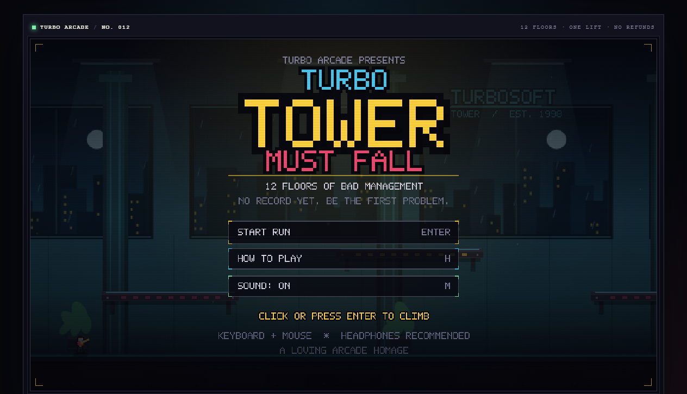
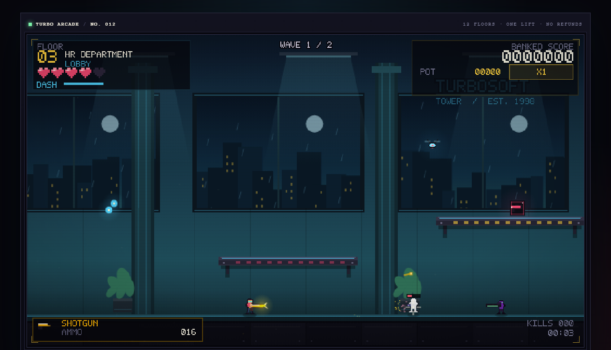
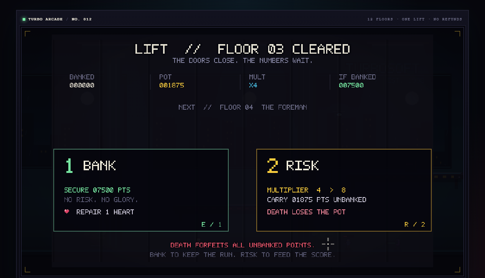
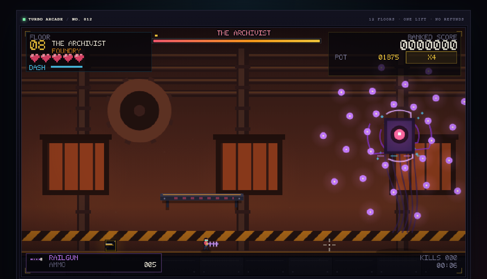

# TURBO TOWER MUST FALL

一款受 **Nitrome Must Die** 启发的单机像素街机射击小游戏。  
你买的终身保修被拒赔了——于是你带着一把手枪，从公司大堂一路打到顶层 CEO 办公室。

**12 层楼。一部电梯。概不退款。**



## 立即开玩

推荐直接双击：

**`TURBO_TOWER_MUST_FALL.html`**

这是一个完全离线的单文件版本（HTML + CSS + JS 全部内嵌，约 186 KB），不需要安装、不需要联网、不需要本地服务器。

也可以打开源码版 `index.html`（需要保留同目录下的 `style.css` 和 `js/`）。

> 建议使用桌面版 Chrome / Edge / Firefox，耳机或音箱体验更好。  
> 第一次点击画面会启动 WebAudio 合成音乐与音效。

## 操作

| 操作 | 按键 |
|---|---|
| 移动 | `A` / `D` 或方向键 |
| 跳跃 | `Space`（有土狼时间与跳跃缓冲） |
| 冲刺 | `Shift`（带短暂无敌帧） |
| 瞄准 | 鼠标 |
| 射击 | 按住鼠标左键（或 `J`） |
| 乘电梯 | `E`（清空楼层后靠近右侧电梯） |
| 暂停 | `Esc` / `P` |
| 静音 | `M` |
| 全屏 | `F` |
| 银行 / 风险 | `1` / `2`（或 `E` / `R`） |

## 核心玩法

- **清空每层的 2 波敌人**，然后走到右侧电梯按 `E` 上楼。
- **每 4 层一场 Boss 战**：FOREMAN-9、THE ARCHIVIST、CEO PRIME。三套完全不同的攻击模式，全部带预警。
- **拾取武器**：手枪无限弹药；霰弹枪、冲锋枪、火箭筒、磁轨炮从补给箱或敌人身上掉落。不同武器有不同节奏与用途。
- **银行 / 风险**：
  - **BANK**：把当前底分 × 倍率结算为保底分，并回复 1 颗心；
  - **RISK**：倍率翻倍，底分继续留在场上；
  - **死亡会失去所有未结算底分**，所以每一层都要决定：落袋为安，还是再赌一把。
- **连杀倍率**：短时间连续击杀会提高单次得分。
- **最高分与最远楼层**保存在本地。

## 内容量

- 12 个手工排布的楼层，4 种区域主题：LOBBY / FOUNDRY / DATA VAULT / ROOFTOP
- 3 个多阶段 Boss
- 7 种敌人：GOON、RUNNER、DRONE、TURRET、GUARD、BOMBER、SCOPE
- 5 种武器
- 完整的标题、教学、暂停、电梯过场、银行/风险、死亡结算、通关与最高分流程
- 纯 WebAudio 合成的芯片音乐与音效（无外部音频素材）
- 纯 Canvas 程序化像素美术（无外部图片素材）
- 屏幕震动、命中停顿、粒子、弹壳、伤害数字、连杀提示、低血量暗角





## 项目结构

```
turbo-tower-must-fall/
├── index.html                  # 源码版入口
├── style.css                   # 街机框体 / CRT 外观
├── js/
│   ├── core.js                 # 数学、5x7 像素字体、WebAudio 合成器
│   ├── data.js                 # 武器、敌人、楼层、区域配置
│   ├── art.js                  # 精灵、背景、平台、电梯、Boss 绘制
│   └── game.js                 # 输入、物理、AI、战斗、流程、HUD
├── TURBO_TOWER_MUST_FALL.html  # 单文件离线版（推荐游玩）
├── screenshots/                # 预览图
└── tools/
    └── build-single.mjs        # 生成单文件版
```

## 构建单文件版

```bash
node tools/build-single.mjs
```

会在项目根目录生成 `TURBO_TOWER_MUST_FALL.html`。

## 设计说明

这个项目刻意保留了老式 Flash 街机游戏的手感：

- 640×360 的内部分辨率 + 整数像素缩放；
- 所有文字使用自绘 5×7 点阵字体；
- 所有图形使用 Canvas 基本图元与像素贴图，不依赖图片；
- 所有声音由振荡器与噪声实时合成；
- 关卡是“短波次 + 电梯 + 赌分”的循环，而不是长流程关卡，适合反复挑战高分。

## 声明

本项目是出于对 Nitrome 经典 Flash 游戏 **Nitrome Must Die** 的喜爱而制作的原创同人作品，与 Nitrome 没有任何关联。  
代码与美术均为本项目原创，可自由学习、修改与非商业分享。
